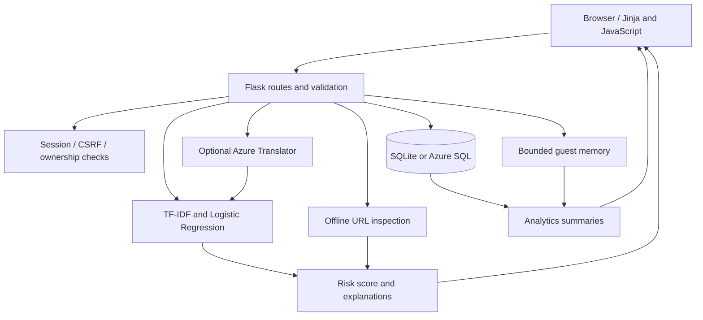
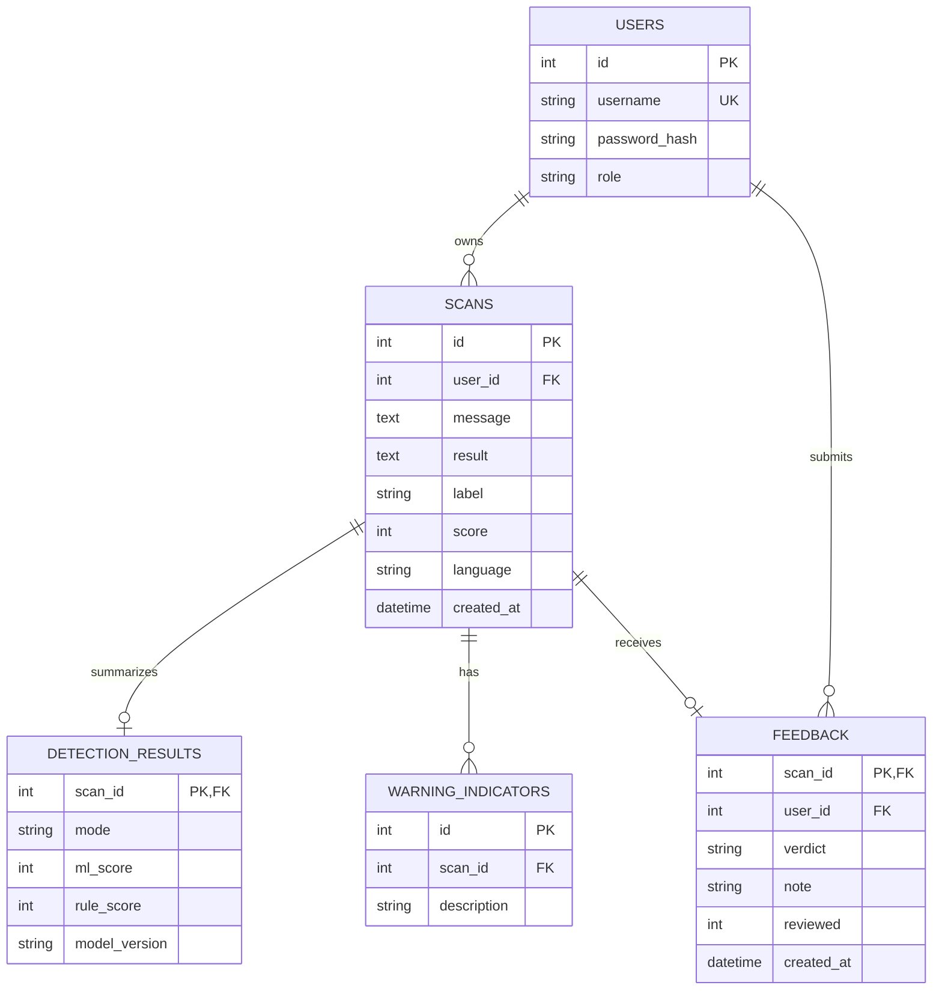

# PhishGuard — project documentation

## 1. Purpose and scope

PhishGuard is a full-stack academic demonstration that helps users inspect suspicious messages and URLs. It combines a trained English SMS spam classifier with explainable message and URL rules, then presents an estimated risk and practical next steps. It does not guarantee safety or replace independent verification.

The six core features are message classification, suspicious URL inspection, risk scores and explanations, scan history, analytics, and secure login with user/admin roles. Additional functionality includes feedback, administrator review, education lessons and a practice challenge.

## 2. Technology

| Layer | Implementation |
|---|---|
| Web server | Python 3.12, Flask; Waitress for the local app |
| Frontend | Jinja templates, CSS, vanilla JavaScript; no frontend build required |
| Model | scikit-learn TF-IDF + Logistic Regression |
| Database | SQLAlchemy with SQLite locally; Azure SQL adapter via pyodbc |
| Optional language service | Azure Translator, converting text to English before analysis |
| Validation | pytest; JavaScript syntax checks and browser review |

Azure resource provisioning and live connectivity verification are deferred. The local demo runs without cloud credentials. Azure SQL requires Microsoft's ODBC Driver 18.

## 3. Architecture

The scanner works as an ordinary server-rendered form and progressively enhances to asynchronous requests. JavaScript submits `FormData`, receives rendered HTML and updates the content area without reloading the entire application. Requests retain same-origin session and CSRF protections.

## 4. Source organization

| Module | Responsibility |
|---|---|
| `app.py` | Application factory, routes, sessions, access checks and request handling |
| `models_db.py` | SQLAlchemy relational entities |
| `migrations.py` | Additive schema migration and legacy metadata backfill |
| `detector.py` | Translation adapter, inference, message rules, phrase segments and redaction |
| `url_analysis.py` | Offline URL parsing, validation and structural indicators |
| `analytics.py` | Counts, activity, indicators and feedback summaries derived from records |
| `learning.py` | Fictional lessons and practice questions |
| `config.py` | Server environment configuration |
| `azure_diagnostics.py` | Secret-safe offline status and optional live connection checks |
| `templates/` | Shared shell, scanner, results, accounts, history, dashboards and lessons |
| `static/` | Editorial stylesheet, theme preference and interaction scripts |
| `train_model.py` | Reproducible training and evaluation |

## 5. Relational model

`schema_versions` records migration versions. Usernames are unique. Scan owner, label and timestamp indexes support lookups and reporting. One current feedback assessment is retained per account-owned scan; resubmission updates it and resets its review status. Deletes remove dependent rows in the same transaction. A JSON result snapshot is retained for compatibility while result metadata and warning indicators also have explicit relational tables.

Guests use an isolated, bounded process-memory workspace instead of database accounts. A guest workspace holds up to 25 recent scans. The process holds at most 500 guest workspaces. Guest feedback and entered Translator keys are also temporary. Restarting the app clears process-local state.

## 6. Request flow

1. The user selects message or URL mode and submits content.
2. Flask validates CSRF, request limits, mode, text length and language.
3. Non-English message mode optionally calls Azure Translator; missing or failed translation is reported explicitly.
4. Message mode runs the trusted classifier and text rules. URL mode uses structural rules without a URL-trained ML model.
5. The response displays the risk, separate model/rule signals, safely escaped highlights, URL components and advice.
6. Guest metadata enters temporary history. An account user can opt into saving metadata to the database.
7. Message previews require a separate explicit opt-in. History, detail and feedback operations check ownership.

## 7. Model and scoring

Dataset: UCI SMS Spam Collection, with provenance included in `data/DATASET_README.txt`. Identical `(message, label)` pairs are deduplicated before splitting. The pipeline uses TF-IDF word unigrams/bigrams and Logistic Regression with balanced class weights. A stratified 80/20 split uses seed 42.

| Held-out measure | Value |
|---|---:|
| Training messages | 4,136 |
| Test messages | 1,035 |
| Spam precision | 90.2% |
| Spam recall | 91.6% |
| Spam F1 | 90.9% |
| Overall accuracy | 97.7% |

These are SMS spam benchmark results, not real-world phishing detection accuracy. Spam is a proxy for scams. Probabilities are not calibrated as safety guarantees. The original v1 training timestamp was not recorded; the model page distinguishes the artifact date from an actual training date. Model version is `sms-lr-v1`. Only load the trusted bundled model artifact.

Text rule weights are 18 for urgency, 22 for credential/code references, 18 for reward lures and 10 for financial/account language. Each category contributes once per message. URL indicators generally add 14 each; descriptions containing lookalike/disguise signals contribute 24. Combined rule totals are capped at 96. Message risk is the greater of the model spam signal × 100 and rule total. URL-only risk is the rule total. Scores are rounded; below 35 is Likely safe, 35–64 Suspicious, and 65+ Phishing/scam.

Rules describe observed indicators rather than causal explanations of model coefficients. The URL lookalike heuristic can produce false positives. No DNS, reputation lookup or destination request is performed. Subdomain display uses simple label splitting, not a public-suffix registry.

Translation support is translation-assisted analysis with the English model. Detection accuracy has not been evaluated for Hindi or the other translation languages.

## 8. Principal routes

| Route | Behavior |
|---|---|
| `GET /` / `POST /` | Scanner and real analysis |
| `/login`, `/register` | Account authentication and registration |
| `POST /guest`, `POST /logout` | Guest entry and session termination |
| `GET /history` | Owned account or guest records |
| `GET /history/<id>` | Owned scan detail |
| `POST /history/<id>/delete` | Delete owned scan and related data |
| `POST /history/clear` | Clear own history and related feedback |
| `GET /history/export.csv` | Privacy-aware owned record export |
| `POST /feedback/<id>` | Submit/update owned-scan assessment |
| `GET /dashboard` | Activity and feedback summaries with date ranges |
| `GET /admin` | Server-protected aggregate dashboard and review queue |
| `POST /admin/feedback/<id>/review` | Administrator review action |
| `/azure`, `POST /azure/test` | Session-local Translator configuration and connection check |
| `/learn`, `/challenge` | Education and local practice score |
| `/integrations`, `/privacy` | Model methodology and privacy information |
| `GET /health` | Database connectivity status without credentials |

## 9. Security and privacy

- Established Werkzeug password hashing; never store plaintext account passwords.
- Signed sessions with HttpOnly and SameSite cookies; HTTPS deployments must enable Secure cookies and a stable environment secret.
- CSRF tokens for state-changing requests, parameterized SQL and server-side role/owner checks.
- Request-size and scan-rate limits, basic authentication throttling, safe error pages, CSP and frame protections.
- No automatic URL fetching; analyzed text is escaped by Jinja, including highlighted segments.
- Metadata-only scan history by default. Optional previews mask email addresses, long digit sequences, credential assignments and URL query details, with clearly disclosed redaction limits.
- Persisted URL snapshots omit paths and query values; live translations and phrase-highlight segments are not retained.
- CSV formula prefixes are neutralized. Owners can delete their records; related database rows are removed transactionally.
- Keys and database credentials are excluded from source control. The Azure form never returns a saved key to the browser.
- User feedback is unverified and never automatically retrains the model.

Rate limits and guest state are process-local. This demo uses one server process; multiple instances require shared server-side state, distributed limits and an operational retention policy. Public production operation also needs monitoring and a more complete threat/privacy review.

## 10. Validation and demonstration

The project has 28 passing automated tests for authentication, CSRF, authorization, cross-user isolation, redaction/escaping, scan persistence, URL validation, feedback review, deletion, CSV export, analytics, rate limits, repeatable migrations and secret-safe Azure diagnostics. Browser checks covered real asynchronous scans, URL mode, mobile menus, desktop/mobile layouts, theme switching, learning scores and guest navigation.

See `DEMO_CHECKLIST.md` for the presentation sequence. `README.md` contains installation/run commands. `AZURE_SETUP.md` covers later database creation, driver installation and live checks; no Azure hosting or connectivity is claimed as completed.

## 11. Academic coverage

| Subject | Demonstrated concepts |
|---|---|
| DBMS | Related tables, keys, indexes, transactions, migration, ownership queries and reporting |
| System Design | Modular services, request/data flow, reusable templates and asynchronous enhancement |
| Cloud Security | Authentication, authorization, CSRF, input validation, secret configuration and Azure separation |
| PBL-III / AI-ML | Trained inference, reproducible held-out evaluation, explicit heuristic signals and feedback for future evaluation |

The project makes no claim about individual student contributions or commit authorship beyond the actual repository history.
