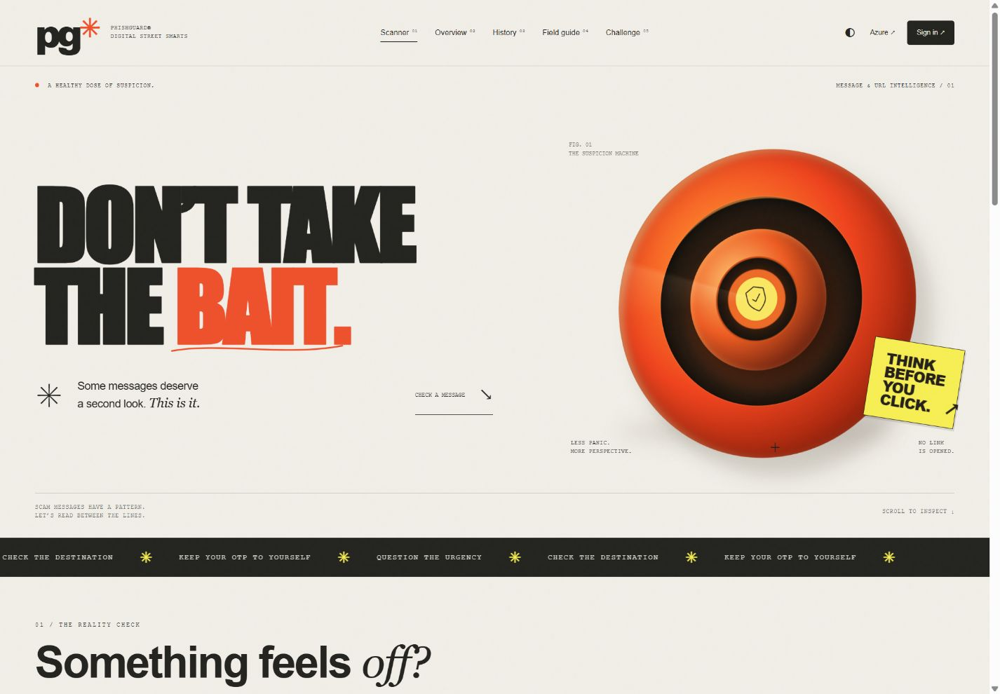

# PhishGuard

A full-stack academic demo: Flask, scikit-learn, Azure Translator and Azure SQL.



**Documentation:** [Project report and architecture](PROJECT_DOCUMENTATION.md) · [Demo checklist](DEMO_CHECKLIST.md) · [Azure setup](AZURE_SETUP.md) · [Design notes](DESIGN_NOTES.md)

The platform upgrade adds a dark/light interface, dedicated URL scanner, phrase highlighting, feedback and admin review, date-filtered analytics, education and a learning challenge. See `UPGRADE_NOTES.md` for the current feature inventory, additive database migration, 28-test validation and remaining limits. Metadata is now retained without message text by default; redacted previews require an explicit opt-in.

## Quick start (Windows / VS Code terminal)

```powershell
py -3.12 -m venv .venv
.\.venv\Scripts\python.exe -m pip install -r requirements.txt
Copy-Item .env.example .env
.\.venv\Scripts\python.exe app.py
```

Open http://127.0.0.1:5000 and create an account. A trained model is included. Use Python 3.12 and `requirements-lock.txt` for exact model/runtime reproducibility.

Create an administrator through the server terminal (no public role assignment):
```powershell
.\.venv\Scripts\python.exe -m flask --app app:create_app create-admin
```

## Azure Translator

Create a Translator resource in Azure. Copy its key and region into `.env` using `.env.example`; use the global text endpoint shown there. Restart the application. Choose Hindi or auto-detect and scan a synthetic message. English bypasses translation. Missing or failed translation is reported; it is never silently simulated. The key remains on the server. Users must consent to sending text to Azure by selecting translation; the scanner states this behavior.

Official API: https://learn.microsoft.com/en-us/azure/ai-services/translator/text-translation/reference/v3/reference

## Azure SQL / DP-900

1. Create an Azure SQL Database and logical server in your subscription. Review the selected pricing before provisioning.
2. Install Microsoft's ODBC Driver 18 for SQL Server on the app host.
3. Permit only the app host's client IP in the server firewall. Use encryption and certificate validation.
4. Put the encrypted ODBC connection string into `AZURE_SQL_CONNECTION_STRING` in `.env`. Restart. Startup creates tables; bad connection settings fail explicitly instead of silently falling back.
5. Register a new account in Azure SQL mode; SQLite accounts/history do not migrate automatically.
6. Verify `/health`, scan a message, then inspect the dashboard and Azure SQL Query Editor.

```sql
SELECT label, COUNT(*) AS scans, AVG(CAST(score AS FLOAT)) AS average_risk
FROM scans GROUP BY label;
SELECT u.username, COUNT(s.id) AS saved_scans
FROM users u LEFT JOIN scans s ON s.user_id = u.id
GROUP BY u.username;
```

DP-900 mapping: structured relational data; primary and foreign keys; managed PaaS database; OLTP scan inserts; transactions; SQL GROUP BY / AVG reporting; authentication, firewall, encryption in transit. Translator is an AI service, not a database service. This demo does not implement a data warehouse, Fabric or Synapse.

Official Python connectivity: https://learn.microsoft.com/en-us/azure/azure-sql/database/azure-sql-python-quickstart

## Azure App Service

Use a Python 3.12 Linux App Service, deploy this directory, install requirements, and use startup command:
```text
gunicorn --bind=0.0.0.0:8000 --workers 1 --timeout 90 'app:create_app()'
```
The host needs ODBC Driver 18 for Azure SQL (use a custom container if unavailable). Set environment variables in App Service Configuration, including a random stable `SECRET_KEY` and `COOKIE_SECURE=true`, enable HTTPS-only and use Azure SQL for shared persistent data. The local SQLite mode is for a single-host demo, not multi-instance deployment. App Service default filesystem behavior depends on deployment; do not depend on local database persistence.

## Model and honest limitations

Dataset: UCI SMS Spam Collection (Almeida & Hidalgo), https://archive.ics.uci.edu/dataset/228/sms+spam+collection . Original dataset and attribution are in `data/`. Deduplicate before a stratified 80/20 split (seed 42). TF-IDF word 1–2 grams + balanced Logistic Regression. `models/metrics.json` contains held-out metrics; `train_model.py` reproduces training. Only load the included trusted model artifact.

Spam is a proxy for scam detection. Benchmark accuracy is not real-world phishing accuracy. The combined risk is the maximum of the model spam score and a weighted warning-sign heuristic, capped at 96 for rules. Thresholds: <35 likely safe; 35–64 suspicious; ≥65 phishing/scam. The score is not a calibrated probability. Rule reasons describe matched indicators, not model causality. URL analysis examines structure only; no destination fetching, DNS lookup or reputation service. Translation can change meaning and must be evaluated separately.

## Privacy and security

Hashed passwords; server-side authorization; per-user history; CSRF tokens; escaped templates; input size limits; parameterized SQL; security headers; basic per-process login throttling. Saved message text masks email addresses and digit sequences of four or more; names, URL strings and other personal information can remain. Uncheck history storage for sensitive text. Original text is not stored unless it survives this limited redaction. Administrator analytics expose aggregate counts, not other users' message bodies. A real public service needs stronger shared rate limiting, operational monitoring, retention policies and broader privacy review.

## Testing
```powershell
.\.venv\Scripts\python.exe -m pip install pytest
.\.venv\Scripts\python.exe -m pytest -q
```
Tests cover scan persistence/deletion, tenant isolation, admin authorization, CSRF, escaping, redaction, translation request structure and baseline examples. Live Azure validation needs customer credentials and is separate from mocked adapter tests.

## Guest workspace and connection form

Scanner, History, Overview and Azure settings work without sign-in. Guests have up to 25 recent redacted scans in bounded server memory, isolated by a random browser-session identifier. Restarting the server clears these scans. Accounts retain database-backed history. Guest history and Azure form credentials require a single server process; use a shared server-side session store before scaling to multiple workers or instances. A browser session can also be restored by browser session-restore features; use the remove-key action to explicitly disconnect.

The Azure button accepts a Translator resource key and region. Keys remain in a bounded server-side memory store and are never embedded in the signed session cookie, returned in HTML or written to project files. The form marks settings as configured, not verified; a translated scan makes the real API call. Database credentials remain owner-managed environment settings. History supports search and risk filtering. Results support clipboard copying and a downloadable text report.

## Five-minute demonstration

1. Create a user; explain password hashes and roles.
2. Scan the everyday example, then the bank impersonation example. Explain ML score and rule evidence.
3. Inspect link flags; demonstrate that links are not clickable or fetched.
4. Select Hindi/auto-detect with Azure configured and show the English translation.
5. Show history, deletion and the dashboard; switch to an admin account for workspace aggregates.
6. Show Azure SQL mode, the related tables and GROUP BY query. Explain OLTP vs aggregate reporting.

## Final local handoff

Use `Start-PhishGuard.ps1` to launch the app from VS Code. Use `Start-PhishGuard.ps1 -CheckOnly` for secret-safe configuration diagnostics. `DEMO_CHECKLIST.md` describes the live demonstration. `AZURE_SETUP.md` covers creating Azure SQL, installing ODBC Driver 18 and verifying both services when the account owner is ready. Live Azure provisioning and testing are intentionally deferred; the app is complete for local demonstration.
